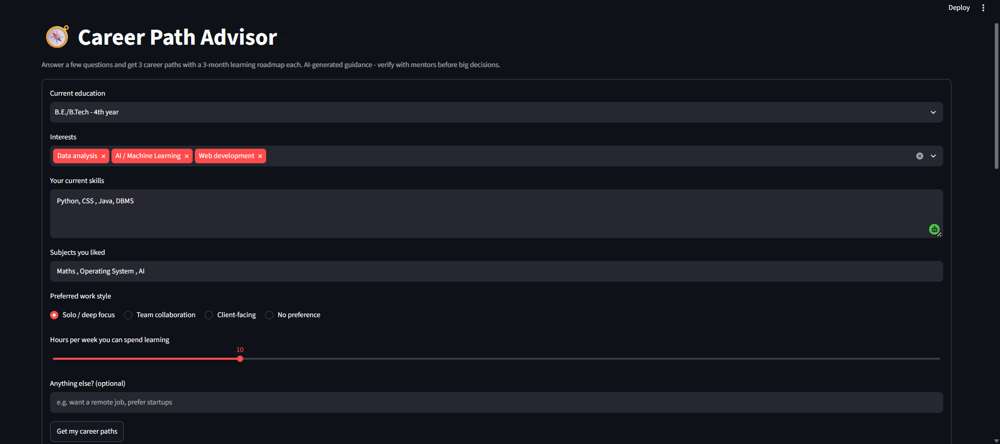
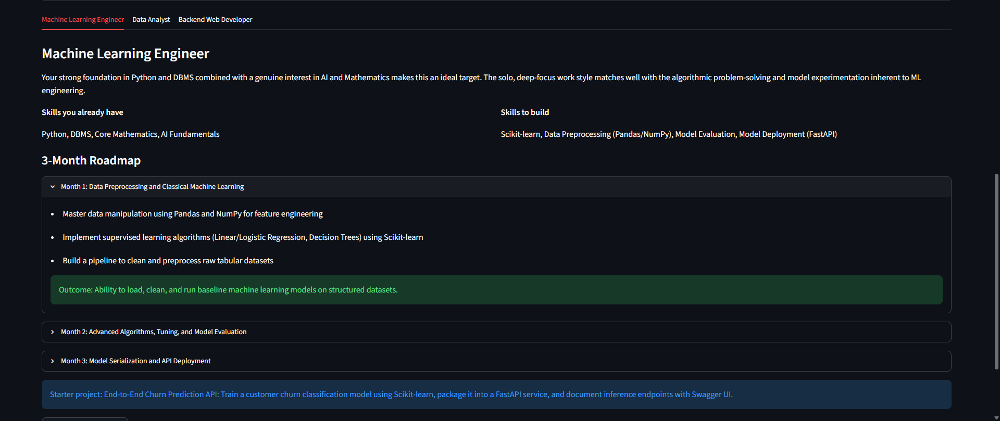

# PS45 - Career Path Advisor

**Problem statement:** Students are unsure which role suits them. This app takes a short questionnaire
(interests, skills, subjects liked) and suggests 3 career paths, each with a 3-month learning roadmap.

**Tech:** Python, Streamlit, Gemini 2.5 Flash (Google GenAI API)

## How to run
1. Get a free API key from https://aistudio.google.com/apikey
2. Copy `.env.example` to `.env` and paste your key
3. `pip install -r requirements.txt`
4. `streamlit run app.py`

## Screenshots

### Main Application

### Project Output
